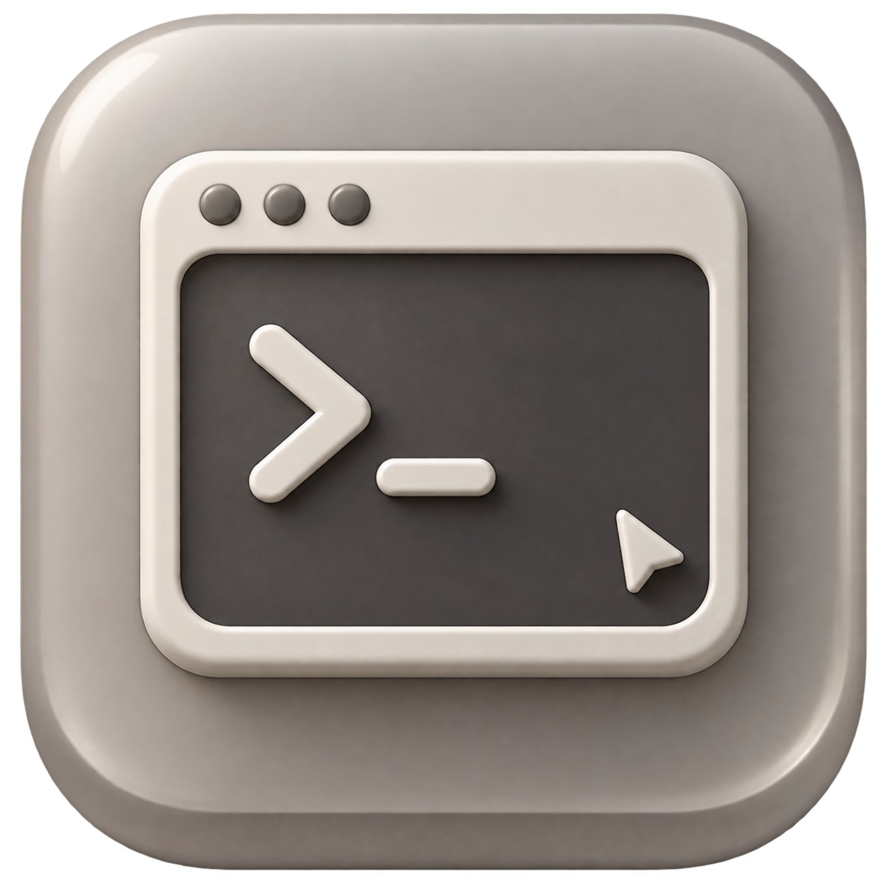

<p align="center">
  
</p>

<h1 align="center">SiCode</h1>

<p align="center">OpenCode 桌面端的二开分支（Electron + SolidJS）。</p>

---

## 这是什么

SiCode 基于 [opencode](https://github.com/sst/opencode) 源码，**只对桌面端应用做品牌化二开**：应用名、图标、应用标识、深链协议、更新通道全部换成 SiCode；内核（CLI / server / TUI）保持上游实现不变，以便持续同步上游修复。

| 项目 | 上游 | SiCode |
| --- | --- | --- |
| 产品名 | OpenCode | **SiCode**（dev 为 `SiCode Dev`，beta 为 `SiCode Beta`） |
| appId | `ai.opencode.desktop` | **`com.sicode.desktop`**（dev/beta 加 `.dev` / `.beta` 后缀） |
| 安装包名 | `opencode-desktop-*` | **`sicode-desktop-*`** |
| 深链协议 | `opencode://` | **`sicode://`**（同时兼容解析 `opencode://`） |
| 更新源 | `opencode.ai/update/...` | **GitHub Releases**（`milusvip/sicode`） |
| 图标 | 上游 logo | `packages/desktop/icons/**` 全套图标 + `packages/ui/src/assets/brand/logo-mark.png` |

上游的托管服务（OpenCode Zen / OpenCode Go / OpenCode Console 账号体系）仍是外部服务，代码里保留了原名，不影响登录与计费。

## 目录

```
packages/
  desktop/          桌面端（Electron 主进程 + preload + renderer 启动壳）← 二开重点
  app/              共享前端 UI（SolidJS，桌面端与 Web 共用）
  ui/               设计系统与 Logo / Wordmark 组件
  cli/ server/ core/ …  引擎与 CLI（上游原样保留）
```

品牌相关改动点集中在：

- `packages/desktop/electron-builder.config.ts`：productName / appId / 协议 / 更新源 / 安装包名
- `packages/desktop/src/main/constants.ts`：运行时应用名、appId、协议常量
- `packages/desktop/scripts/copy-metainfo.ts`：Linux metainfo
- `packages/desktop/icons/{dev,beta,prod}/**`：安装包与窗口图标
- `packages/ui/src/components/logo.tsx`、`packages/ui/src/typography/wordmark/wordmark.tsx`：应用内标识
- `packages/app/src/runtime/i18n/*`、`packages/gui-extensions/src/**/i18n/*`：界面文案

## 开发

要求：Bun 1.4+、Node 22+。Windows 上建议用扁平依赖布局安装（隔离布局在部分环境下不会链接无 scope 的包）：

```bash
bun install --linker=hoisted
```

启动桌面端开发模式：

```bash
bun run dev:desktop
```

Windows 上直接双击根目录的 `dev.bat` 即可（再双击一次就是重启：会先停掉已在运行的实例、释放 3084 端口、清掉 `out/` 再启动）。它同时处理了本机常见的三个环境坑：

- 清空 `ELECTRON_RUN_AS_NODE`（否则 Electron 会被当成 Node 跑）
- `OPENCODE_DESKTOP_DISABLE_GPU=1`（沙箱/远程会话里 GPU 进程会带崩渲染进程）
- `OPENCODE_DESKTOP_REMOTE_DEBUGGING_PORT=9333`（避开被占用的 9222）

`dev:desktop` 默认从源码构建本地 server；也可以下载指定版本的 CLI：

```bash
bun run dev:desktop -- --download-server 2.1.3
```

只构建产物（不启动）：

```bash
bun run --cwd packages/desktop build
```

类型检查与测试：

```bash
bun run --cwd packages/desktop typecheck
bun test --cwd packages/desktop
```

## 打包

```bash
# dev 渠道（下载上游 CLI 到 resources/）
OPENCODE_CHANNEL=dev bun run --cwd packages/desktop package

# 正式渠道（需要先构建 CLI 并指定产物目录）
OPENCODE_CHANNEL=prod OPENCODE_CLI_DIST=<cli 构建输出> bun run --cwd packages/desktop package:win
```

产物输出在 `packages/desktop/dist/`，命名为 `sicode-desktop-<os>-<arch>.<ext>`。

> 打包会使用上游 `opencode-cli` 二进制作为 sidecar（`resources/opencode-cli*`）。如需完全自研内核，替换 `packages/desktop/scripts/utils.ts` 中的 CLI 解析逻辑即可。

## 替换 Logo

1. 把新图（1024×1024 以上、正方形、圆角外为纯白背景）放到 `packages/desktop/branding/logo-source.png`；
2. 重新生成全套图标（脚本会裁切圆角、生成 ico/icns/png/favicon）：

```bash
bun add -d sharp png2icons   # 仅生成图标时需要
node script/brand/generate-icons.mjs packages/desktop/branding/logo-source.png .
```

生成结果会覆盖 `packages/desktop/icons/{dev,beta,prod}`、`packages/ui/src/assets/brand`、`packages/ui/src/assets/favicon`、`packages/app/public`。

## 同步上游

不整体 merge 上游，按需摘取。先列清单，再挑需要的提交单独移植：

```bash
git remote add upstream git@github.com:sst/opencode.git
git fetch upstream
git log --oneline 76fd05ff45..upstream/dev   # 列出上游更新，分类挑选
git cherry-pick <sha>                        # 只移植需要的提交
```

品牌相关文件是本地改动，冲突时以 SiCode 为准（见上文改动点清单）。完整流程和取舍标准见 [UPSTREAM.md](./UPSTREAM.md)。

## 许可

MIT，见 [LICENSE](LICENSE)。原始版权归 OpenCode / Anomaly Innovations Inc. 所有；SiCode 仅做桌面端品牌与配置层面的二次开发。
